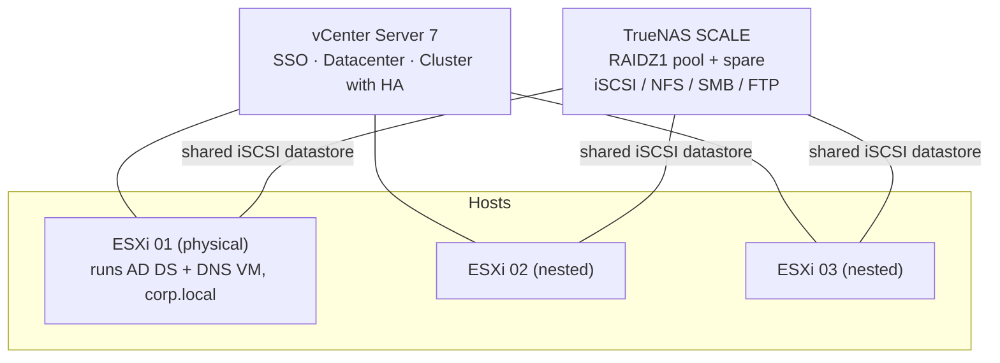

# VMware vSphere & TrueNAS Infrastructure

An enterprise-style virtualization lab: **three ESXi hosts managed by vCenter**, **shared storage on TrueNAS SCALE** (iSCSI, NFS, SMB, FTP), virtual networking (VSS and VDS), Active Directory integration, VM templates and cloning, and **vSphere HA** on a shared iSCSI datastore.

> Internship project — ENSA Fès IT department (DUT Networks & Telecommunications, EST Fès, 2023–2024).

## Goals

- Compare NAS solutions and deploy one for centralized backup and file sharing
- Build a multi-host VMware environment the way a small company or school would run it
- Provide high availability for virtual machines through a cluster and shared storage

## Architecture



The physical server (1 TB disk, 30 GB RAM, one NIC on the school LAN) hosts two **nested ESXi** virtual hosts, giving a three-host cluster on a single machine.

## Part 1 — Network storage with TrueNAS SCALE

**Why TrueNAS:** after comparing FreeNAS, OpenMediaVault, OpenFiler and NAS4Free (file systems, OS base, virtualization support, Active Directory sync, open source), TrueNAS was chosen for its ZFS foundation, Active Directory support and protocol coverage.

| Service | What was configured | Test |
|---|---|---|
| **Pool** | RAIDZ1 (RAID 5-equivalent) plus one hot **spare** disk | Pool created and healthy |
| **SMB** | Local group + user, dataset with ACL permissions, SMB share | Mounted from Windows, files created and copied |
| **NFS** | Dataset, dedicated user and group, NFS share | Mounted from an Ubuntu VM on the same network |
| **iSCSI** | Portal, initiator access, authenticated user, **zvol**, extent, target, wizard | Attached to a Citrix XenServer (via XenCenter) and to a Windows machine (iSCSI Initiator, then disk init + NTFS) |
| **FTP** | Dataset, user with permissions, FTP service | File uploaded from Windows |

## Part 2 — VMware vSphere

| Area | What was done |
|---|---|
| **ESXi 7** | Installed, static IP set from the console, **VMFS 6** datastore created, test VM created from an uploaded ISO |
| **Nested lab** | Two ESXi hosts virtualized inside the physical ESXi |
| **vCenter 7** | Two-stage deployment, SSO domain, datacenter created, three hosts added |
| **Networking** | Standard switch (**VSS**) with port group; **Distributed switch (VDS)** with the three hosts and uplinks mapped, distributed port groups |
| **Content library** | Published library holding a Windows Server 2019 ISO |
| **Identity** | Windows Server 2019 VM running **AD DS + DNS** (domain `corp.local`, forward and reverse zones); Windows 10 client joined; an ESXi host joined to the domain and tested with a user from the *ESX Admins* group; vCenter SSO using AD as an LDAP identity source and role assignment to a domain user |
| **Services** | IIS web server and IIS FTP server VMs registered in DNS and tested from the client |
| **VM lifecycle** | Windows 10 **template**, deployment from template, VM **cloning** |
| **High availability** | **Cluster** with the three hosts and **vSphere HA** enabled (requires the shared iSCSI datastore from TrueNAS) |

## Validation

- SMB, NFS, iSCSI and FTP each tested from a real client
- DNS resolution verified with `nslookup` from the domain-joined client
- Login to ESXi and vCenter verified with an Active Directory account
- VM shown as **protected by HA** in the cluster summary

## Repository structure

```
docs/
  lab-walkthrough.md        step-by-step summary of every build phase
  storage-comparison.md     NAS solutions comparison and decision
screenshots/                installer, pool creation, shares, vCenter, cluster...
configs/                    DNS zone names, share settings (no secrets)
```

## What I learned

- Nested virtualization to simulate multi-host environments on limited hardware
- Why shared storage is the prerequisite for HA, vMotion and DRS
- How identity (AD, DNS, SSO) underpins a healthy vSphere environment
- Differences between VSS and VDS and when to centralize network configuration

## Author

El Mehdi Boussalem — supervised by Mr Zakariae Maach (ENSA Fès) and Pr. Jamal Belkadid (EST Fès).

## Disclaimer

Lab and training environment. Passwords shown in the original report are not reproduced here.
